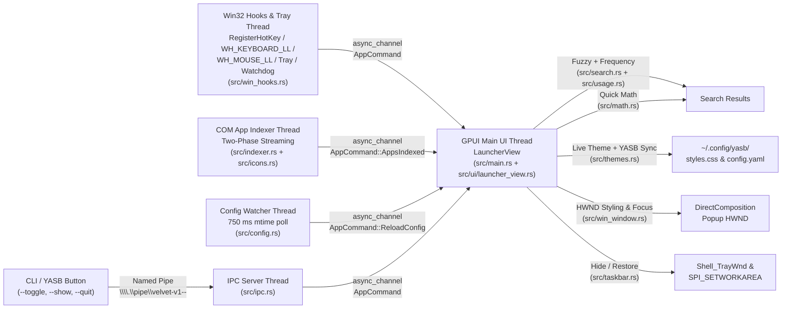
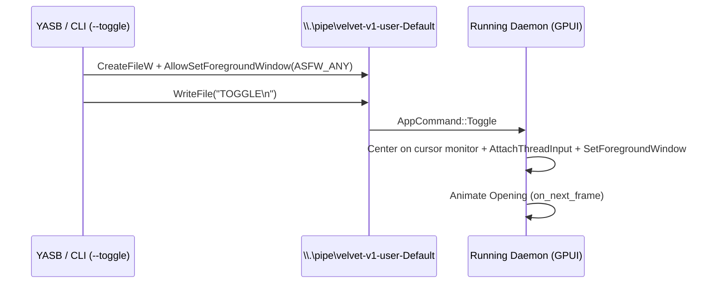
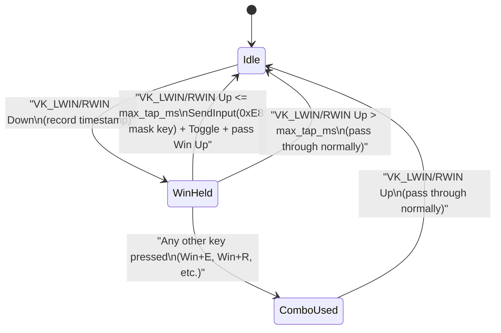

# Velvet Architecture

**Velvet** (`velvet.exe`) is a native Windows 11 application launcher built in Rust with **GPUI** (`gpui = "0.2.2"`) and direct Win32 APIs (`windows = "0.58"`). It runs as a lightweight single-instance background daemon so invoking it opens immediately without cold-start latency.

---

## 1. High-Level Architecture

---

## 2. Threading & Concurrency Model

| Thread | Entry Point | Responsibility |
| :--- | :--- | :--- |
| **Main / GPUI UI Thread** | `src/main.rs` (`Application::new().run(...)`) | Owns `LauncherView`, runs DirectComposition GPU rendering, keyboard dispatch, animations, and consumes `AppCommand` messages via an async `cmd_rx.recv().await` task. |
| **Win32 Hooks & Tray Thread** | `src/win_hooks.rs` (`spawn`) | Runs a dedicated Win32 `GetMessageW` loop on a hidden helper window (`VelvetHelperWnd`). Hosts `RegisterHotKey`, live-toggleable `WH_KEYBOARD_LL`, `WH_MOUSE_LL`, system tray `Shell_NotifyIconW` (`Theme ▸`, Win-key hook, taskbar, autostart), `TaskbarCreated` recovery, `WM_ENDSESSION`, and dynamic `SetWinEventHook` + 250 ms backup timer while taskbar hiding is active. |
| **Named Pipe IPC Server Thread** | `src/ipc.rs` (`spawn_ipc_server`) | Blocks on `CreateNamedPipeW` / `ConnectNamedPipe` for CLI signals (`--toggle`, `--show`, `--hide`, `--theme`, `--toggle-taskbar`, `--reload`, `--quit`) and forwards them into `async-channel`. |
| **COM App Indexer Thread(s)** | `src/main.rs` (`spawn_indexer_thread`) | Initializes COM (`COINIT_APARTMENTTHREADED`), runs a fast pass over `FOLDERID_AppsFolder` + Start Menu (`< 40ms`) to unblock search immediately, then extracts 48px icons and sends the enriched list. |
| **Config Watcher Thread** | `src/config.rs` (`spawn_config_watcher`) | Polls `config.toml`'s modification timestamp every 750 ms; on valid TOML changes, sends `AppCommand::ReloadConfig` for zero-restart live updates. |

All cross-thread events converge through a single lock-free `async_channel::unbounded::<AppCommand>()` ([src/commands.rs](src/commands.rs)).

---

## 3. Module Map

| File | Responsibility |
| :--- | :--- |
| [src/main.rs](src/main.rs) | CLI argument parsing, single-instance IPC client forwarding, panic hook (`last-panic.log` + taskbar restore), `TaskbarGuard`, GPUI `WindowKind::PopUp` setup, and async command router. |
| [src/commands.rs](src/commands.rs) | `AppCommand` enum shared across IPC, Win32 hooks, tray menu, and indexer. |
| [src/config.rs](src/config.rs) | `Config` schema (`window`, `hotkeys`, `taskbar`, `search`, `theme`), `#RRGGBB`/`#RRGGBBAA` -> `gpui::Hsla` parser, hotkey string parser (`Alt+Space`, etc.), atomic `save_config`, `spawn_config_watcher`, and `%APPDATA%\velvet\config.toml` auto-creation. |
| [src/themes.rs](src/themes.rs) | Built-in `ThemePreset` definitions (`CarbonDark`, `TokyoNight`, `CatppuccinMocha`), drop-in custom `%APPDATA%\velvet\themes\*.toml` loader (`ThemeChoice`), swatch colors, and optional live YASB sync (`sync_yasb_theme`). |
| [src/ui/launcher_view.rs](src/ui/launcher_view.rs) | GPUI `LauncherView` (`Render`, `Focusable`), I-beam flush header with 530 ms blinking caret, shaped hit-test mouse/keyboard selection (`Ctrl+A/C/X/V`, `Shift+Arrows`) with horizontal scroll tracking, virtualized `uniform_list` with fuzzy character highlighting, app pinning (`Ctrl+P` / row pin button), `Shift+↵` elevation, two-step power confirmation, thin scroll cue, math/command rows, and frame-driven fade/slide animations. |
| [src/indexer.rs](src/indexer.rs) | Two-phase `index_all_apps_streaming` (`FOLDERID_AppsFolder` + Start Menu `.lnk`/`.exe`), `FindFirstChangeNotificationW` Start Menu auto-watcher (0% idle CPU), `>` command runner, built-in system/power actions, `ShellExecuteW` launch (`open`/`runas`), and power calls (`LockWorkStation`, `SetSuspendState`, `shutdown.exe`). |
| [src/icons.rs](src/icons.rs) | `IShellItemImageFactory::GetImage` -> `GetDIBits` 32-bit top-down BGRA -> GPUI `RenderImage`, plus supersampled SVG rasterizer ([assets/velvet.svg](assets/velvet.svg)) for the 64×64 tray `HICON` and multi-resolution [assets/velvet.ico](assets/velvet.ico). |
| [build.rs](build.rs) | Locates Windows SDK `rc.exe`, compiles [assets/velvet.rc](assets/velvet.rc), and embeds `assets/velvet.ico` directly into `velvet.exe`. |
| [src/search.rs](src/search.rs) | `nucleo-matcher` fuzzy ranking, prefix/word-boundary boosts, pinned-first sorting on empty queries + pin boost during search, `UsageStore` frequency boost, and inline math insertion. |
| [src/math.rs](src/math.rs) | Zero-dependency recursive-descent math parser (`+ - * / % ^`, parentheses, `sqrt`, `abs`, `round`, `floor`, `ceil`, `sin`, `cos`, `tan`, `ln`, `log`, `pi`, `e`, `0x` hex, optional leading `=`). |
| [src/usage.rs](src/usage.rs) | Atomic JSON persistence of launch count, recency, and pinned favorites (`pinned` / `pinned_at_unix`) in `%APPDATA%\velvet\usage.json`. |
| [src/ipc.rs](src/ipc.rs) | Desktop-scoped (`GetThreadDesktop` + `GetUserObjectInformationW`) Win32 Named Pipe client/server + `AllowSetForegroundWindow(ASFW_ANY)` focus handoff. |
| [src/win_window.rs](src/win_window.rs) | `WS_EX_TOOLWINDOW | WS_EX_TOPMOST`, DWM border/corner/non-client suppression (`DWMWA_BORDER_COLOR`, `DWMWA_WINDOW_CORNER_PREFERENCE`, `DWMWA_NCRENDERING_POLICY = DWMNCRP_DISABLED`), `GWLP_WNDPROC` `WM_SETTINGCHANGE` re-entrancy guard (preventing GPUI `0.2.2` `RefCell` panics during `SHAppBarMessage`/`SPI_SETWORKAREA`), transparent shadow margins (`WINDOW_PAD_*`), cursor-monitor DPI centering, and `AttachThreadInput` focus acquisition. |
| [src/win_hooks.rs](src/win_hooks.rs) | `RegisterHotKey`, live-toggleable `WH_KEYBOARD_LL` lone-Win tap hook, DPI-aware inset `WH_MOUSE_LL` click-outside hook, tray icon/menu (`Theme ▸`, Win-key hook, taskbar, autostart), and event-driven `SetWinEventHook` + backup timer taskbar watcher. |
| [src/autostart.rs](src/autostart.rs) | Manages `%APPDATA%\Microsoft\Windows\Start Menu\Programs\Startup\Velvet.lnk` via COM `IShellLinkW` / `IPersistFile`. |
| [src/taskbar.rs](src/taskbar.rs) | Multi-monitor `explorer.exe`-filtered `Shell_TrayWnd` / `Shell_SecondaryTrayWnd` disabling & hiding (`ABM_SETSTATE`, `EnableWindow(false)`, `SW_HIDE` + `SWP_HIDEWINDOW`), initial edge-aware `SPI_SETWORKAREA` (preserving top AppBars like YASB), `250 ms` exposure watchdog, `taskbar-hidden.flag` recovery, and RAII `TaskbarGuard`. |

---

## 4. Key Subsystems

### 4.1 Single-Instance IPC & Focus Handoff
When `velvet.exe --toggle` is invoked (e.g. from a YASB bar button), the short-lived CLI process avoids GPUI startup altogether:

If no pipe server exists (cold start), the process continues into normal daemon initialization and opens the window once initialized (`show_on_boot`).

---

### 4.2 Two-Phase Indexing & BGRA Icon Pipeline
1. **Phase 1 (Metadata, < 40 ms):** Enumerates `FOLDERID_AppsFolder` (`BHID_EnumItems`) for UWP/Store (`aumid` containing `!`) and desktop apps, then walks `%ProgramData%\Microsoft\Windows\Start Menu\Programs` and `%APPDATA%\Microsoft\Windows\Start Menu\Programs` deduplicating by normalized app name. Emits `AppsIndexed` immediately so apps are usable right away.
2. **Phase 2 (Icons):** On the same STA COM thread, calls `IShellItemImageFactory::GetImage(48x48, SIIGBF_BIGGERSIZEOK | SIIGBF_ICONONLY)` -> `GetDIBits` (`biHeight = -h` top-down 32-bit BGRA). Legacy 32bpp icons with zeroed alpha are fixed in-place. Because GPUI's `RenderImage` natively expects **BGRA** inside `image::ImageBuffer<Rgba<u8>, Vec<u8>>`, no R/B channel swap is performed.

---

### 4.3 Lone `Win` Key & Click-Outside Hooks (`src/win_hooks.rs`)
The optional `WH_KEYBOARD_LL` hook (`intercept_win_key = true`) suppresses the Windows Start Menu only on a clean tap-and-release of `VK_LWIN`/`VK_RWIN` without ever leaving the `Win` modifier stuck:

While the launcher is visible (`LAUNCHER_VISIBLE`), a lightweight `WH_MOUSE_LL` hook checks `WM_*BUTTONDOWN` coordinates against `GetWindowRect(LAUNCHER_HWND)` (after a 150 ms open grace window) and dispatches `AppCommand::Hide` whenever you click outside — even over desktop background or always-on-top bars where Windows focus-blur events don't always fire.

---

### 4.4 AppBar-Safe Windows 11 Taskbar Hiding (`src/taskbar.rs`)
Hiding the taskbar naively by calling `ShowWindow(SW_HIDE)` alone or setting `rcWork = rcMonitor` fails on Windows 11 24H2/26H2 (Explorer re-shows `Shell_TrayWnd` on bottom-edge hover or fights `SPI_SETWORKAREA`, and resetting `rcWork` indiscriminately erases YASB's 36px top AppBar). Instead:
1. Before hiding, `taskbar.rs` locates Explorer's real `Shell_TrayWnd` (filtering out dummy `0x0` `Shell_TrayWnd` windows created by third-party bars like YASB via `QueryFullProcessImageNameW`), records `SHAppBarMessage(ABM_GETSTATE)`, and snapshots each monitor's `rcWork` (`EnumDisplayMonitors`) and taskbar edge (`Bottom`, `Top`, `Left`, `Right`). If Windows auto-hide was OFF, it applies `ABM_SETSTATE(ABS_AUTOHIDE)` so Windows releases its docked taskbar reservation cleanly.
2. Each `Shell_TrayWnd` / `Shell_SecondaryTrayWnd` is disabled (`EnableWindow(false)`) and hidden (`SW_HIDE` + `SetWindowPos(..., SWP_HIDEWINDOW | SWP_NOZORDER | SWP_NOACTIVATE)`), then ONLY the monitor edge occupied by the taskbar is expanded to `rcMonitor` via `SPI_SETWORKAREA`, leaving YASB's top reservation intact.
3. While hidden, `win_hooks.rs` attaches an out-of-context `SetWinEventHook` (`EVENT_OBJECT_SHOW` + Explorer-scoped `EVENT_OBJECT_LOCATIONCHANGE`) plus a 250 ms backup timer so any Explorer attempt to re-surface or re-enable a taskbar window is re-hidden cleanly—without re-running `SPI_SETWORKAREA`, avoiding work-area thrashing with top bars (YASB) and tiling window managers (GlazeWM).
4. On toggle off, exit, panic (`std::panic::set_hook`), `TaskbarGuard::drop`, `WM_QUERYENDSESSION`/`WM_ENDSESSION`, or `--show-taskbar`, `IS_HIDDEN` is cleared first, taskbar windows are shown (`SW_SHOWNA` without `SWP_FRAMECHANGED`, nudging focus on `Shell_TrayWnd` if Windows Auto-Hide is active so it slides up cleanly), and original `ABM_SETSTATE` and saved work areas are restored. A small `%APPDATA%\velvet\taskbar-hidden.flag` also auto-heals stale `SW_HIDE` state on next launch if an instance was ever terminated forcibly.

---

### 4.5 Live Theme Switching, `config.toml` Hot-Reload & YASB Sync (`src/themes.rs`, `src/config.rs`)
1. **Instant In-Launcher Switch:** Selecting `Theme: <Preset>` (or running `velvet.exe --theme <slug>`) updates `LauncherView.config.theme` and `LauncherView.theme` in memory immediately — repainting Velvet live while keeping the window open — while preserving font settings (`font_family`, `mono_font_family`, `font_size`) and `sync_yasb`.
2. **Persistence & Watcher:** `config::save_config` writes `%APPDATA%\velvet\config.toml` atomically (`.toml.tmp` + rename). Manual edits to `config.toml` are picked up within 750 ms by `spawn_config_watcher`.
3. **Lossless Live YASB Sync (`sync_yasb = true`):**
   - Uses `%USERPROFILE%\.config\yasb\styles.css.velvet.bak` as the canonical lossless CSS master so switching back and forth never drifts or compounds color replacements.
   - Updates only the 4 inline theme color keys in live `config.yaml` (`circle_background_color`, `circle_work_progress_color`, `circle_break_progress_color`, `current_line_color`), preserving all widget and layout settings.
   - Writes `styles.css` and `config.yaml` **directly in-place via `std::fs::write`** (rather than temp-file + `rename`). On Windows, `rename` (`MoveFileExW`) emits a `FileMovedEvent`, whereas in-place `fs::write` emits `FILE_ACTION_MODIFIED` directly on the target file — which YASB's `watchdog` stylesheet/config watcher picks up and reloads live without restarting YASB.

---

## 5. Runtime Files

| Path | Purpose |
| :--- | :--- |
| `%APPDATA%\velvet\config.toml` | User configuration (or portable `config.toml` next to `.exe`). |
| `%APPDATA%\velvet\usage.json` | Launch frequency, recency (`ln_1p` score boost), and pinned favorites (`pinned` / `pinned_at_unix`). |
| `%APPDATA%\Microsoft\Windows\Start Menu\Programs\Startup\Velvet.lnk` | Windows autostart shortcut managed via the tray menu (**Start with Windows**) and [src/autostart.rs](src/autostart.rs). |
| `%APPDATA%\velvet\taskbar-hidden.flag` | Present while taskbar hiding is active; auto-restores the taskbar on next startup if a prior process ended uncleanly. |
| `%APPDATA%\velvet\last-panic.log` | Written if a GUI-subsystem panic ever occurs. |
